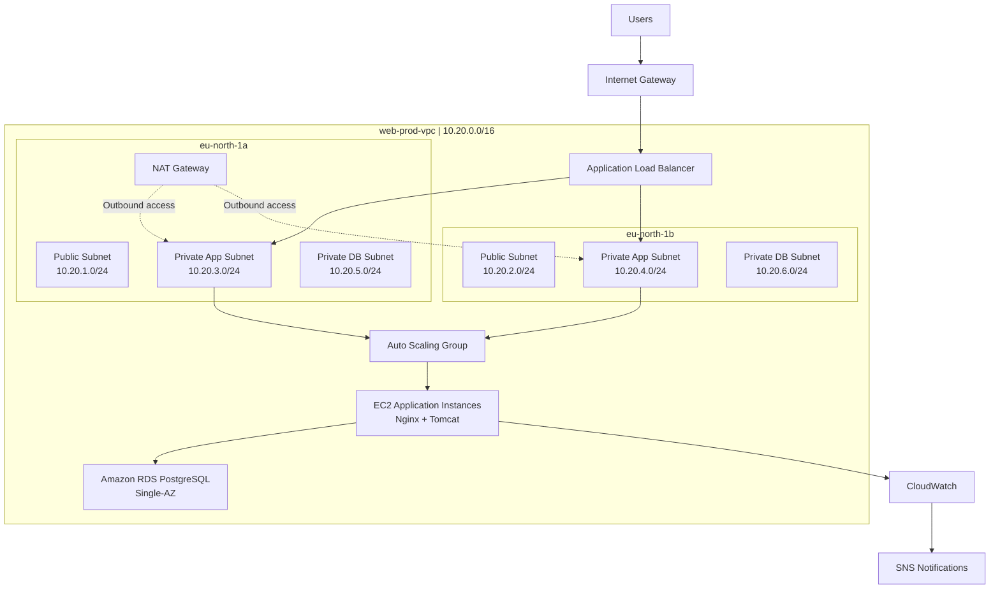

# AWS Production Web Application Infrastructure

A hands-on AWS Cloud Engineering project focused on designing, deploying, and monitoring a production-style web application infrastructure.

## Project Overview

This project demonstrates how multiple AWS services work together to host a web application with load balancing, automatic scaling, private networking, managed database integration, and infrastructure monitoring.

The infrastructure was built in the **AWS Stockholm Region (eu-north-1)**.

## Architecture

## AWS Services Used

| Service | Purpose |
|---|---|
| Amazon VPC | Isolated cloud network |
| EC2 | Application hosting |
| Application Load Balancer | Incoming traffic distribution |
| Auto Scaling Group | Automatic instance scaling |
| AMI | Reusable EC2 machine image |
| RDS PostgreSQL | Managed relational database |
| IAM | EC2 role and access management |
| Internet Gateway | Internet connectivity |
| NAT Gateway | Outbound internet access from private subnets |
| CloudWatch | Metrics, monitoring and alarms |
| SNS | Alert notifications |

## Infrastructure Configuration

- **Region:** eu-north-1 (Stockholm)
- **VPC CIDR:** 10.20.0.0/16
- **Availability Zones:** eu-north-1a and eu-north-1b
- **Public Subnets:** 10.20.1.0/24 and 10.20.2.0/24
- **Private Application Subnets:** 10.20.3.0/24 and 10.20.4.0/24
- **Private Database Subnets:** 10.20.5.0/24 and 10.20.6.0/24
- **NAT Gateways:** 1
- **Application Load Balancer:** Internet-facing, HTTP listener
- **Auto Scaling:** Minimum 1, Desired 1, Maximum 3
- **Database:** Amazon RDS PostgreSQL, Single-AZ

## Application Stack

- Amazon Linux 2023
- Java 17 (Amazon Corretto)
- Nginx
- Apache Tomcat 10.1
- PostgreSQL

Nginx was configured as a reverse proxy for the Tomcat application. The application was validated through the Application Load Balancer.

## Database Integration

Amazon RDS PostgreSQL was deployed in private database subnets.

Database connectivity was tested from the application EC2 environment using the PostgreSQL client. JDBC integration was also implemented to validate application-to-database connectivity.

## Monitoring and Alerting

Amazon CloudWatch was configured to monitor infrastructure performance.

Monitoring included:
- EC2 CPU utilization
- Auto Scaling Group CPU utilization
- RDS CPU utilization
- Database connections and storage metrics
- CloudWatch alarms
- SNS notification integration

## Security Considerations

- Application EC2 instances deployed in private subnets.
- RDS database configured without public accessibility.
- Security Groups used to restrict traffic between application and database tiers.
- IAM role attached to EC2 for Systems Manager access.
- PostgreSQL access restricted to the application Security Group.
- Tomcat application port was not directly exposed to the internet.

## Documentation

Detailed implementation steps, AWS configuration screenshots, architecture information, validation and troubleshooting notes are available in the project documentation.

**[View Project Documentation](AWS_Project_1_Premium_GitHub_Portfolio.pdf)**

## Key Learnings

- AWS VPC and subnet architecture
- Public and private network design
- EC2 deployment and administration
- Application Load Balancer configuration
- Launch Templates and Auto Scaling
- RDS PostgreSQL integration
- Linux, Nginx and Tomcat configuration
- CloudWatch monitoring and SNS notifications
- Infrastructure troubleshooting

## Project Status

**Completed – Hands-on AWS implementation and documentation.**

This project is part of my ongoing Cloud Engineering and DevOps learning journey.
