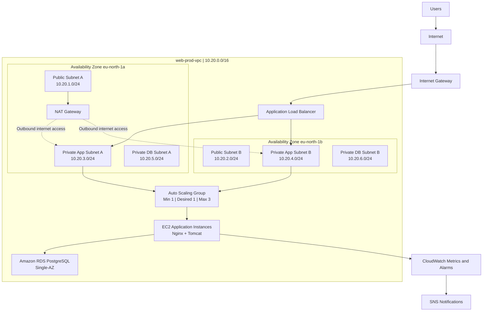

# AWS Project 1 – Architecture Diagram

**Region:** eu-north-1 (Stockholm)

## Architecture Notes

- The Application Load Balancer distributes incoming HTTP traffic to application instances.
- EC2 instances run in private application subnets.
- Auto Scaling manages application instance capacity.
- A single NAT Gateway provides outbound internet access.
- RDS PostgreSQL is private and configured as Single-AZ.
- CloudWatch and SNS provide monitoring and alert notifications.

**Note:** This is a lab implementation. The single NAT Gateway and Single-AZ database are not fully redundant configurations.
